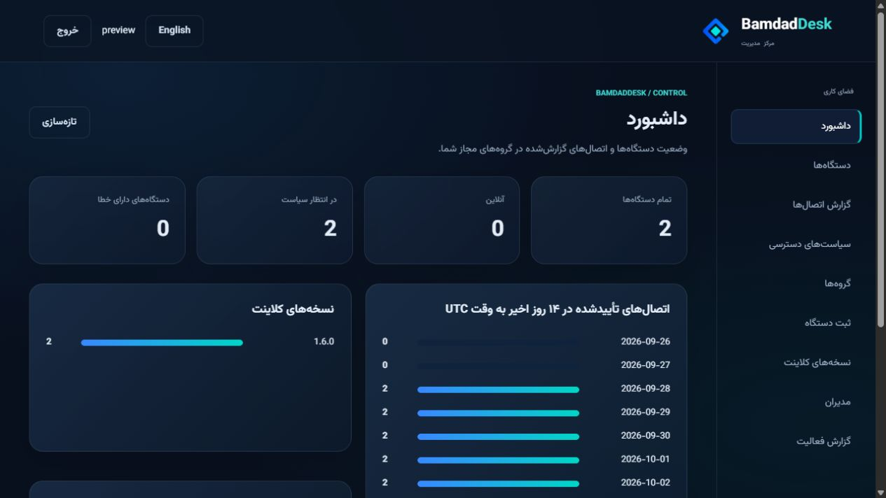
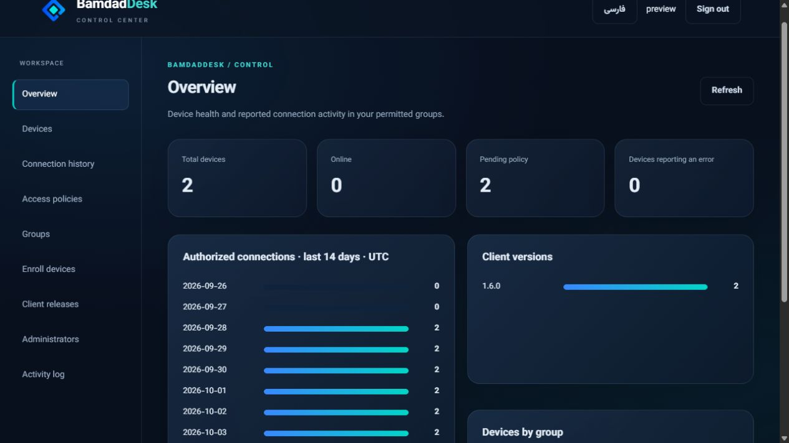
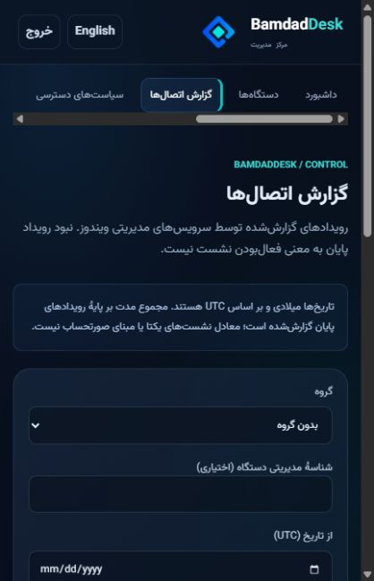

# پنل مدیریت BamdadDesk

این مخزن عمومی شامل **تمام سورس پنل، فایل‌های Docker و نصب‌کنندهٔ تعاملی** است. نصب پنل به حساب گیت‌هاب یا توکن مخزن خصوصی نیاز ندارد. رابط به‌صورت پیش‌فرض انگلیسی است و فارسی، راست‌به‌چپ و فونت محلی وزیرمتن را پشتیبانی می‌کند.

این انتشار آزمایشی است. پنل برای **کلاینت مدیریتی سازگار BamdadDesk** ساخته شده؛ RustDesk معمولی خودکار به آن متصل نمی‌شود. فایل اجرایی اختصاصی سازمان، تنظیمات خصوصی و رمز پیش‌فرض مشترک در این مخزن وجود ندارد.

## تصاویر پنل

تصاویر با داده‌های نمایشی تهیه شده‌اند.




## نصب با یک دستور

سیستم‌های پشتیبانی‌شدهٔ نصب‌کننده: **Ubuntu 22.04/24.04 و Debian 12/13** با systemd، دسترسی root یا sudo و اینترنت. برای شروع ۲ هسته و ۲ گیگابایت RAM در نظر بگیرید؛ فضای دیسک به تعداد نسخه‌های کلاینت بستگی دارد و ظرفیت واقعی باید متناسب با بار شما آزموده شود.

```bash
sudo bash -c 'set -e; if ! command -v curl >/dev/null; then apt-get update; apt-get install -y curl ca-certificates; fi; installer=$(mktemp); trap '\''rm -f "$installer"'\'' EXIT; curl --proto "=https" --tlsv1.2 -fsSL https://raw.githubusercontent.com/mahdinosrati/BamdadDesk-Control/v1.2.0/install.sh -o "$installer"; bash "$installer"'
```

اگر با root وارد شده‌اید، `sudo` ابتدای دستور را حذف کنید. دستور حتی curl را در صورت نیاز نصب می‌کند. رمز مدیر و رمز ریموت داخل ترمینال و بدون نمایش دریافت می‌شوند؛ هیچ رمز ثابتی برای همهٔ نصب‌ها تعیین نشده است.

نصب‌کننده دامنه، روش HTTPS، پورت، اطلاعات مدیر و تنظیمات اختیاری ID server، relay و کلید عمومی hbbs را می‌پرسد. پیش‌نیازها، Docker و Compose در صورت نیاز نصب می‌شوند. اگر Docker قبلاً نصب است، همان موتور استفاده می‌شود؛ بسته‌های متعارض خودکار حذف نمی‌شوند.

### اجرا با IP، بدون دامنه و SSL

گزینهٔ **۳ — HTTP** را انتخاب کنید، IPv4 سرور و پورت آزاد (پیش‌فرض 8080) را وارد کنید. لینک مانند `http://YOUR-IP:8080` خواهد بود؛ DNS و گواهی لازم نیست. پورت انتخاب‌شده باید در فایروال سرور/دیتاسنتر باز باشد. HTTP رمز و اطلاعات را بدون رمزنگاری منتقل می‌کند و برای تست در نظر گرفته شده است؛ کلاینت مدیریتی ویندوز همچنان به HTTPS نیاز دارد.

هنگام ساخت مدیر، رمز در ترمینال نمایش داده نمی‌شود؛ آن را تایپ کنید و Enter بزنید. تا تکمیل این مرحله سرویس وب اجرا نمی‌شود. اکنون لینک قبل از شروع و در پایان، حتی هنگام خطا، چاپ می‌شود؛ دیدن لینک به‌تنهایی به معنی سلامت سرویس نیست.

برای تغییر IP، دامنه، پورت یا حالت HTTPS بعد از ارتقای سورس، دستور زیر را اجرا کنید. داده‌ها و مدیر موجود حفظ می‌شوند:

```bash
sudo bash /opt/bamdaddesk-control/manage.sh configure
```

### نصب روی سرور فعلی RustDesk

- اگر پورت ۸۰ و پورت HTTPS موردنظر آزادند: حالت **Automatic HTTPS** را انتخاب کنید. رکوردهای A/AAAA دامنه باید به این سرور برسند و پورت ۸۰ برای صدور/تمدید گواهی باز بماند. HTTPS پیش‌فرض ۴۴۳ است و قابل تغییر است.
- اگر وب‌سرور یا reverse proxy دارید: حالت **Existing reverse proxy** را انتخاب کنید. یک پورت محلی آزاد، مثلاً ۱۸۰۸۰، درخواست می‌شود. سپس مسیر دامنه را طبق [نمونهٔ تنظیمات](docs/INSTALL.md#existing-reverse-proxy) در پراکسی خود اضافه کنید. این حالت یک مرحلهٔ تنظیم پراکسی دارد؛ نصب‌کننده تنظیمات وب‌سرور موجود را حدس نمی‌زند.

سرویس‌های hbbs/hbbr، سایر کانتینرها و قوانین فایروال تغییر نمی‌کنند. باز کردن پورت در فایروال دیتاسنتر یا روتر به عهدهٔ مدیر سرور است. اگر دامنه یا گواهی درست نباشد، نصب‌کننده موفقیت HTTPS را اعلام نمی‌کند.

## ارتباط با کلاینت

۱. نسخهٔ مدیریتی سازگار BamdadDesk را روی ویندوز نصب کنید تا سرویس آن فعال شود.

۲. در پنل، گروه و توکن ثبت دستگاه ایجاد کنید.

۳. فایل [Register-Client.ps1](client/Register-Client.ps1) را با دسترسی Administrator اجرا کنید و نشانی HTTPS پنل، کلید عمومی امضای پنل و توکن را وارد کنید.

۴. در پنل، زمان آخرین heartbeat و شمارهٔ سیاست **اعمال‌شده** را بررسی کنید. صرف دیده‌شدن دستگاه به معنی اعمال موفق تنظیمات نیست.

پنل از API برای ثبت دستگاه، دریافت وضعیت، توزیع سیاست امضاشده و نسخه‌های جدید استفاده می‌کند. تصویر و کنترل ریموت از مسیر RustDesk و hbbs/hbbr عبور می‌کند. ریموت داخل مرورگر در این نسخه وجود ندارد.

## مدیریت روزانه

```bash
sudo bash /opt/bamdaddesk-control/manage.sh status
sudo bash /opt/bamdaddesk-control/manage.sh logs
sudo bash /opt/bamdaddesk-control/manage.sh backup /srv/bamdad-backups
```

سورس و تنظیمات در `/opt/bamdaddesk-control` و داده‌ها در `/var/lib/bamdaddesk-control` هستند. بکاپ شامل پایگاه داده، کلید امضا، فایل‌های نسخه‌ها و تنظیمات نصب است و باید محرمانه نگهداری شود. گم‌شدن کلید امضا به ثبت مجدد اعتماد کلاینت‌ها نیاز دارد.

برای ادامهٔ نصب قطع‌شده پس از ساخت فایل تنظیمات:

```bash
sudo bash /opt/bamdaddesk-control/manage.sh resume
```

این دستور مدیر موجود را بازنشانی نمی‌کند. روش بازیابی، ارتقا، خطاهای پورت و HTTPS و محدودیت‌ها در [راهنمای عملیات](docs/OPERATIONS.md) و [راهنمای نصب](docs/INSTALL.md) آمده است.

## راهنمای فایل‌ها و توسعه

| مسیر | کاربرد |
| --- | --- |
| `control/` | API، احراز هویت، سیاست‌ها، گزارش‌ها و SQLite |
| `static/` | رابط انگلیسی/فارسی، CSS، JavaScript و فونت‌ها |
| `client/` | اسکریپت ثبت کلاینت سازگار ویندوز |
| `Dockerfile` و `compose*.yaml` | ساخت و اجرای ایزولهٔ پنل |
| `install.sh` و `scripts/install-lib.sh` | نصب تعاملی و بررسی دامنه/پورت |
| `manage.sh` | وضعیت، لاگ، ادامهٔ نصب و بکاپ |
| `tests/` و `.github/workflows/ci.yml` | آزمون API، نصب‌کننده و Docker |

برای توسعه از Python 3.12 و دستورهای [README انگلیسی](README.md#development) استفاده کنید. معماری و مرزهای اعتماد در [ARCHITECTURE](docs/ARCHITECTURE.md)، تفاوت انتشار عمومی با پروژهٔ اصلی در [CHANGELOG](CHANGELOG.md) و مجوز AGPL در [LICENSE](LICENSE) ثبت شده‌اند.

## راهنمای نسخهٔ ۱٫۲

[راهنمای کامل فارسی از نصب تا نگهداری](docs/HANDBOOK.fa.md) · [English handbook](docs/HANDBOOK.md)

ثبت خودکار با نصاب سازمانی، مدیریت و تمدید توکن، ویرایش گروه، خروجی CSV با فیلتر، پیام روشن فرم مدیر، منوی لینوکس، نصب اختیاری RustDesk و SSL خودکار اضافه شده‌اند. جزئیات سازگاری کلاینت و مهاجرت آدرس API در راهنما آمده است.

سازنده: **مهدی نصرتی** — [ایمیل](mailto:mahdinosrati06@gmail.com) · [تلگرام](https://t.me/MiNosrati).


