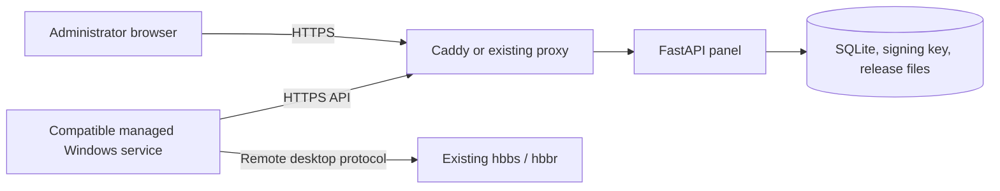

# Architecture and client compatibility

The management API and the RustDesk remote desktop servers have different roles. The panel does not relay screens or replace hbbs/hbbr. No RustDesk Pro backend is copied or required.

`control/app.py` implements authentication, inventory, enrollment, policies and releases. `storage.py` owns SQLite and Ed25519 signing. `scopes.py` enforces administrator group scope. `reporting.py` stores client-reported connection events and generates reports. `catalog.py` defines supported policy keys, with `policy-schema.json` as the exported compatibility catalog. `static/` is the browser UI and local font assets.

## Trust flow

1. A Windows administrator configures the exact HTTPS panel origin and its Ed25519 public key and supplies a limited-use enrollment token.
2. Enrollment returns a separate device credential. The panel stores its hash; the Windows service protects the original credential with local administrator/SYSTEM ACLs.
3. Heartbeats fetch device-bound, revisioned signed policies. The client verifies the configured signing key and applies supported settings. A later heartbeat reports the applied revision or an error.
4. Global policy is combined with group and device overrides. Session access settings and permanent password overrides are policy data; they are separate from panel administrator passwords.
5. The client reports connection events and checks signed release manifests. Downloaded artifacts are hash-verified; installing an update needs user action.

Use the generated OpenAPI schema at `/openapi.json` on your own panel for request/response shapes, and [tests](../tests/) for enrollment, signature, scope and reporting examples. The compatible BamdadDesk 1.6 pilot service polls policy approximately every 60 seconds, events every 5 seconds and releases every 20 minutes. Those are client implementation details, not a guarantee for third-party implementations.

## Public project boundary

The initial panel source was extracted from BamdadDesk's management component at parent commit `a183325`. This repository publishes that independent component plus deployment tooling, not the private RustDesk-derived Windows source tree. Compatible client source/binaries must be obtained or developed separately under their applicable licenses. The included registration script cannot make an unmodified RustDesk executable compatible.

Private server addresses, organization presets, enrollment secrets and Windows build outputs are deliberately absent. All installation-specific values are entered by the operator and kept outside version control. Application/API behavior is unchanged by this extraction; Docker networking and installation are the new deployment surface.
